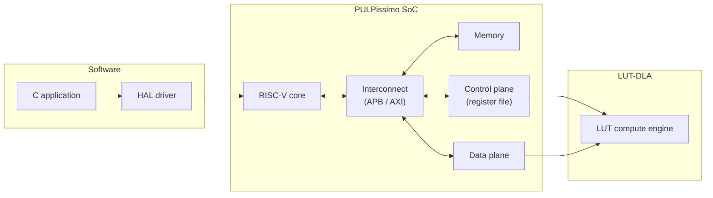

# Hi, I'm Nancy 👋

### SoC Integration Engineer · RTL Verification Engineer · Digital IC Design

*Bridging silicon and software: from C driver down to the gates.*

---

## 🧭 About Me

I'm a Communication & Information Engineering graduate (Capital University, class of 2026) working at the boundary between hardware and software. As **technical lead** of my graduation project **RISCyLUT** (sponsored by Si-Vision, rated *Excellent*), I integrated a custom **LUT-based Deep Learning Accelerator (LUT-DLA)** into a **PULPissimo RISC-V SoC**, covering architecture, RTL, verification, and driver-level bring-up.

**What I do**

- 🔌 Integrate SoCs and custom accelerators over AMBA interconnects (APB / AHB / AXI)
- ✅ Build verification environments: module-based, class-based, and UVM-style
- 🧠 Design accelerator-to-core interfaces with clean control/data-plane separation
- 🛠️ Debug at the waveform level before guessing at fixes

**Currently focused on:** deepening digital verification (UVM, assertions, coverage) while growing in SoC integration and accelerator architecture.

**Looking for:** full-time roles in SoC integration, RTL/digital verification, ASIC/digital IC design, or hardware accelerator architecture.

---

## 🏗️ Featured: RISCyLUT

> A LUT-based Deep Learning Accelerator integrated into a PULPissimo RISC-V SoC.

<b>Details: my role, flow, and results</b>

- **Role:** SoC Integration Engineer and RTL Verification Engineer; technical lead
- **Integration:** accelerator attached via memory-mapped registers and a data path, with the control and data planes separated
- **Verification:** testbench environment plus waveform-level hardware/software debug
- **Outcome:** graduation project graded 96/100; team evaluated *Excellent* by sponsor Si-Vision
- **Repo / paper:** _add links here_

---

## 🧰 Tech Stack

| Area | Tools & Skills |
|---|---|
| **RTL Design** | Verilog, SystemVerilog, FSMs, memory-mapped register files, APB/AXI peripherals |
| **Verification** | Module/class-based testbenches, UVM concepts, assertions, QuestaSim |
| **SoC** | RISC-V, PULPissimo, AMBA (APB/AHB/AXI), bus matrix, memory subsystem |
| **Embedded** | C, HAL-style drivers, RISC-V cross-compilation toolchains |
| **Scripting** | Python, Bash, TCL, Makefile |
| **Workflow** | Linux, Git, GitHub |

> ✏️ *Trim this table to tools you've genuinely used. Recruiters will ask about everything on it.*

---

## 📂 Selected Projects

| Project | What it is | Stack |
|---|---|---|
| **[RISCyLUT](https://github.com/YOUR-USERNAME/REPO)** | LUT-DLA integrated into a RISC-V SoC | SystemVerilog, C, QuestaSim |
| **[Project 2](https://github.com/YOUR-USERNAME/REPO)** | One line on the problem and result | … |
| **[Project 3](https://github.com/YOUR-USERNAME/REPO)** | One line on the problem and result | … |

---

## 📊 GitHub Stats

---

## 🎯 Engineering Philosophy

I care about understanding every layer of the stack: C code, instruction semantics, register-transfer logic, and physical gates. Correctness, traceability, and clear documentation matter as much as a working design.

*Open to opportunities, so feel free to reach out.* 🚀

