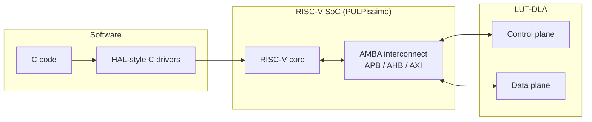

<!-- ========= HEADER ========= -->

 

---

## 👩‍💻 About me

I'm a Communication and Information Engineering graduate (Capital University, formerly Helwan University, class of 2026) based in Cairo, Egypt. I work as an **SoC Integration Engineer** and **RTL Verification Engineer**, and I was **technical lead** of my graduation project, RISCyLUT, sponsored by Si-Vision.

**What I work on**

- 🔗 Hardware-software co-design
- ✅ RTL verification
- 🧩 Digital IC design and SoC integration

**Current focus:** SoC integration, and exploring the world of digital verification.

**Looking for:** full-time roles in RTL design, ASIC / digital IC design, SoC integration, or hardware accelerator architecture, ideally at a company building next-generation silicon for compute or AI.

> 💬 **Engineering philosophy:** I'd rather spend an extra hour reading a waveform than guess at a fix. Correctness, traceability, and clear documentation matter as much as a working design.

---

## 🚀 Featured project: RISCyLUT

**A custom LUT-based Deep Learning Accelerator (LUT-DLA) integrated into a RISC-V SoC (PULPissimo).** I was the **technical lead** and worked as **SoC Integration Engineer** and **RTL Verification Engineer**. The project covers the full stack, from architecture and RTL design to driver development and ASIC synthesis.

-6C3BD1?style=flat-square)

<b>🔬 What I worked on (click to expand)</b>

 

- Integrating the accelerator into the SoC with a suitable choice of interconnects (AHB / APB / AXI)
- Control/data-plane separation for the accelerator interface
- HAL-style C drivers, with hardware/software interaction verified through waveform-level debugging
- A verification environment for the design
- RTL through gate-level synthesis using industry-standard EDA flows

---

## 🛠️ Tech stack

| Area | What I use |
|---|---|
| 🧩 **RTL design** | Parameterized synthesizable Verilog / SystemVerilog, FSM design, memory-mapped register files, custom APB/AXI peripherals |
| ✅ **Verification** | Module-based and class-based testbenches, UVM concepts, assertions, waveform debug in QuestaSim |
| 🔌 **SoC design** | RISC-V SoC integration (PULPissimo / RI5CY), AMBA APB / AHB / AXI4, bus matrix and interconnect architecture |
| 🏭 **Physical design flow** | Pre-place-and-route synthesis, gate-level netlists and timing reports, SAED32 standard-cell library, constraints, Synopsys Design Compiler |
| 🧪 **DFT** | Scan-friendly RTL coding, testbench-driven design validation |
| 💻 **Embedded** | HAL-style C drivers, RISC-V cross-compilation toolchains |
| 📜 **Scripting & OS** | Bash, TCL, Makefile, Python, Linux / WSL, Git / GitHub |

---

## 📊 GitHub stats

---

### 🤝 Let's connect

*Open to full-time opportunities in digital design, verification, and SoC integration.*

<!--
OTHER PROJECTS (hidden until you confirm they are yours; delete the comment markers to show them).
These came from the attached file, which is headed "Mohammed Hussein". No links were provided, so none are added.

### Other projects
- **RTL-to-GDS Implementation of a Low-Power Configurable Multi-Clock Digital System**: UART receiver commands drive register file read/write and ALU processing, with results sent to a UART transmitter through an asynchronous FIFO for clock-domain crossing. Stack: SystemVerilog, C, QuestaSim, Synopsys DC, Cadence SoC Encounter, Formality
- **Single-Cycle MIPS CPU**: from-scratch SystemVerilog implementation of a single-cycle MIPS processor.
- **SPI Slave with Single Port RAM**: synthesizable SPI slave with a self-checking testbench.
-->
